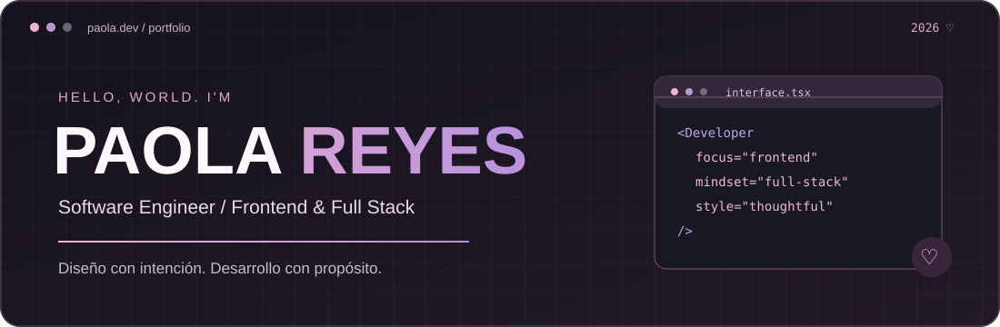

 

### 🌷 ¡Hola! Bienvenido a mi GitHub

*Transformando ideas en soluciones digitales con creatividad, tecnología y un pequeño toque de rosa.*

 

 

**Desarrollo Full Stack** · **UX/UI** · **Inteligencia Artificial** · **Automatización**

---

## 01 / 🌸 Sobre mí

¡Hola! Soy **Paola Reyes**, Ingeniera de Software apasionada por desarrollar soluciones que combinen tecnología, funcionalidad y diseño.

Me gusta participar en todo el proceso de desarrollo: desde crear interfaces intuitivas y responsivas hasta construir APIs, implementar lógica de negocio, administrar bases de datos e integrar sistemas.

Tengo experiencia desarrollando herramientas empresariales para optimizar procesos administrativos, financieros y operativos.

También me interesa explorar cómo la inteligencia artificial y la automatización pueden resolver problemas reales.

- 💻 **Full Stack:** Desarrollo de aplicaciones web completas.
- 🎨 **Frontend y UX/UI:** Interfaces intuitivas y experiencias de usuario.
- ⚙️ **Backend:** APIs REST, lógica de negocio y bases de datos.
- 🤖 **Inteligencia Artificial:** Integración de modelos y procesamiento documental.
- 🔄 **Automatización:** Optimización de procesos e integración de herramientas.
- 🚀 **Tecnología aeroespacial:** Interés por la ingeniería y la exploración espacial.

> "El buen software no consiste solo en escribir código, sino en resolver problemas reales."

---

## 02 / 🛠️ Tecnologías y herramientas

### Frontend

 

### Backend y bases de datos

 

### Herramientas de desarrollo

 

| Especialidad | Tecnologías y conocimientos |
|:---|:---|
| **Frontend** | React, TypeScript, JavaScript, HTML, CSS |
| **Backend** | Node.js, Express, APIs REST |
| **Bases de datos** | MongoDB |
| **Integraciones** | APIs, servicios externos, automatización |
| **Inteligencia artificial** | Procesamiento documental, integración de modelos |
| **Desarrollo** | Git, GitHub, VS Code, Postman |

---

## 03 / 💗 Portafolio — Proyectos destacados

Una selección de soluciones empresariales en las que he trabajado, participando en el desarrollo de interfaces, servicios backend, integraciones y automatización de procesos.

<table>
<tr>
<td width="50%" valign="top">

### 🌸 01. Conciliación Bancaria

**Sistema de gestión financiera**

Plataforma para importar estados de cuenta, relacionar movimientos bancarios con gastos y facilitar la conciliación contable.

**Mi participación:**

- Desarrollo de interfaces y paneles.
- Implementación de lógica backend.
- Integración de APIs y bases de datos.
- Desarrollo y mejora del motor de conciliación.
- Validación de movimientos y coincidencias.

`React` `Node.js` `MongoDB`

</td>
<td width="50%" valign="top">

### 💻 02. Facturación de Gastos

**Gestión administrativa**

Aplicación para registrar, consultar y administrar gastos mediante comprobantes fiscales y documentación digital.

**Mi participación:**

- Desarrollo de formularios y vistas.
- Procesamiento de comprobantes XML.
- Implementación de servicios backend.
- Gestión y consulta de información.
- Integración con almacenamiento de archivos.

`React` `Express` `MongoDB`

</td>
</tr>
<tr>
<td width="50%" valign="top">

### ✨ 03. Sistema de Reclutamiento

**Gestión de talento**

Plataforma para administrar vacantes, candidatos y etapas de selección mediante flujos de trabajo digitales.

**Mi participación:**

- Desarrollo de interfaces administrativas.
- Gestión de estados y permisos.
- Integración de automatizaciones.
- Implementación de funcionalidades backend.
- Seguimiento de procesos de reclutamiento.

`Full Stack` `APIs` `Automatización`

</td>
<td width="50%" valign="top">

### 🤖 04. Procesamiento Documental con IA

**Inteligencia artificial aplicada**

Solución para analizar documentos y fotografías, extraer información relevante y facilitar la generación de reportes.

**Mi participación:**

- Integración de servicios de IA.
- Procesamiento de documentos.
- Desarrollo de interfaces de revisión.
- Extracción y estructuración de información.
- Automatización de tareas.

`IA` `APIs` `Documentos`

</td>
</tr>
</table>

 

<b>🌷 Ver más proyectos y experiencia</b>

 

### 05 / Capacitación y Gestión de Visitadores

Implementación y mejora de procesos digitales para incorporación, capacitación, evaluaciones y seguimiento de personal de campo.

**Áreas de trabajo:**
- Integraciones con plataformas externas.
- Automatización de procesos.
- Formularios y evaluaciones.
- Seguimiento de candidatos.
- Gestión de información.

`Integraciones` `Automatización` `Procesos`

---

### 06 / Herramientas de Control Interno

Desarrollo de funcionalidades para organizar información, generar reportes y facilitar la consulta de documentación empresarial.

**Áreas de trabajo:**
- Generación de reportes.
- Integración con almacenamiento de archivos.
- Desarrollo de interfaces administrativas.
- Procesamiento de información.
- Automatización de tareas.

`React` `Node.js` `Reportes`

 

Los proyectos profesionales se presentan de forma general para respetar la confidencialidad de la información. El código fuente y los repositorios internos no son públicos.

---

## 04 / 🎨 Áreas de especialización

| Área | Enfoque |
|:---|:---|
| **Desarrollo Full Stack** | Aplicaciones web completas, frontend y backend |
| **Diseño de interfaces** | Experiencias intuitivas, responsivas y funcionales |
| **Sistemas empresariales** | Plataformas administrativas y operativas |
| **Backend y APIs** | Servicios, lógica de negocio e integraciones |
| **Inteligencia Artificial** | Extracción y procesamiento inteligente de información |
| **Automatización** | Optimización de flujos de trabajo |
| **Arquitectura de software** | Organización de componentes y sistemas |

---

## 05 / 🌱 Actualmente explorando

---

## 06 / 📊 Actividad en GitHub

 

Las estadísticas públicas de GitHub no necesariamente reflejan el trabajo realizado en repositorios privados o empresariales.

---

### 💗 Conectemos

Siempre estoy interesada en aprender, compartir ideas y explorar nuevas oportunidades para crear soluciones con tecnología.

 

*Seguir aprendiendo. Seguir desarrollando. Seguir creciendo.*

